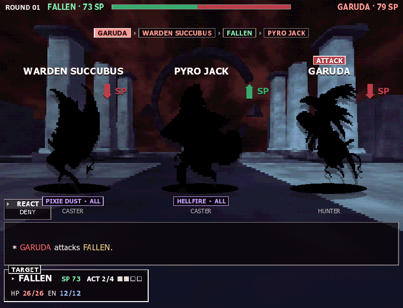

# Necrópole Saturnina

A Necrópole Saturnina é a primeira dungeon do **Survival**. No título, escolha **Survival** para começar no Pórtico dos Que Desistiram. São cinco zonas de 11 salas, com a Ruptura no caminho até o guardião. Derrote-o e use **DESCEND** no santuário para avançar ao segundo estrato. [Modo Survival](SURVIVAL_MODE.md) · [Decisão D-114](DECISIONS.md)

## Direção de arte e maquetes

A necrópole foi concebida para **Sloth**, com a ideia de uma obra funerária que continua inacabada. Túmulos escavados, oficinas abandonadas, escadas interrompidas e instrumentos astronômicos quebrados aparecem ao longo do percurso. Petra, Banditaccia e túmulos egípcios serviram de referência para os espaços funerários. Dürer, Piranesi e Beksiński orientaram o trabalho suspenso, as perspectivas impossíveis e a paisagem desolada. A vista frontal reservou espaço para personagens e inimigos como sprites 2D. [Referências, materiais e estudos A/B/C](../assets/generated/ambiente-e-interacoes/saturnina/LEIA-ME.md)

1. Os estudos A, B e C exploraram pedra funerária, melancolia e iconografia de Saturno. A Ruptura ganhou dois estudos próprios, um para a aproximação pelo exterior e outro para a passagem interna. [Exterior](../assets/generated/ambiente-e-interacoes/saturnina/ruptura/LEIA-ME.md) · [Interior](../assets/generated/ambiente-e-interacoes/saturnina/ruptura/interior/LEIA-ME.md)
2. A primeira maquete contínua ligou as cinco zonas. O pedido por mais de dez salas por zona levou à planta com 55 salas. O refinamento deslocou salas, abriu alcovas e quebrou o alinhamento de 61 passagens. A planta final tem 67 ligações e 13 circuitos independentes. [Maquete do percurso](../assets/generated/ambiente-e-interacoes/saturnina/percurso/LEIA-ME.md) · [Planta e refinamento](../assets/generated/ambiente-e-interacoes/saturnina/percurso/refinamento_55/LEIA-ME.md)
3. O passe de iluminação aplicou o azul de chumbo à pedra e ao piso. Cinco luzes pendulares varrem os marcos das zonas. O céu conserva a paleta vermelha e usa quatro ondas de plasma, inspiradas no fundo D das batalhas, para mover as nuvens. A exploração aplica a LUT e o shader Cartucho ocre + Fita de horror. [Comparação de iluminação](../assets/generated/ambiente-e-interacoes/saturnina/percurso/refinamento_55/video/comparacao_ambiente_chumbo.png) · [Medições](../assets/generated/ambiente-e-interacoes/saturnina/percurso/refinamento_55/video/medidas_fundo_animado.json)

| Zona | Marcos |
| --- | --- |
| I · Pórtico dos Que Desistiram | Santuário na entrada, estela fendida e Ruptura |
| II · Avenida Sepulcral | Galerias funerárias, tumbas e sarcófago destampado |
| III · Claustro da Melancolia | Oficina abandonada, esculturas em talhe e escadas interrompidas |
| IV · Ossuário dos Astrônomos | Nichos funerários, meridiano incompleto e teto aberto |
| V · Sepulcro do Sétimo Peso | Sino rachado, armação orbital e câmara do guardião |

## Do Blender ao Survival

O [exportador](../assets/generated/ambiente-e-interacoes/saturnina/percurso/refinamento_55/exportar_ensaio.py) converte uma cópia da maquete em 87 blocos de malha com 316.044 triângulos e cor por vértice. O Godot reconstrói a pedra, a névoa, a iluminação e o céu para o renderer Compatibility. Quatro unidades do Blender equivalem a uma célula do jogo. A câmera de exploração usa FOV vertical de 77,73° e corte em 5,5 células. [Montagem visual](../scripts/survival/necropole_visual.gd)

A planta geométrica tem 2.676 células. A verificação por raios de piso e deslocamento encontrou 2.639 células alcançáveis e 66 bordas fechadas entre elas. A rota mais curta entre entrada e Sepulcro contém 314 células, incluindo os extremos. Fechar a Ruptura corta essa ligação. O mapa converte os eixos da exportação para as coordenadas do Survival. A movimentação do jogador e dos inimigos usa a mesma grade. [Recurso do mapa](../assets/generated/survival/necropole/mapa.tres) · [Conversão da grade](../scripts/survival/necropole_map.gd) · [Auditoria do Blender](../assets/generated/ambiente-e-interacoes/saturnina/percurso/refinamento_55/auditoria.json)

No primeiro estrato, a semente distribui seis demônios móveis, um grupo humano hostil, três eventos e os recrutáveis disponíveis. O santuário fica no Pórtico e a guardiã Succubus no Sepulcro. Os estratos 2 a 5 continuam procedurais. Ao carregar um save compatível da planta anterior, o primeiro estrato retorna ao Pórtico e refaz a memória espacial, preservando economia e derrotas registradas. [Posicionamento](../scripts/survival/survival_strata.gd) · [Cena de exploração](../scripts/survival/survival_world.gd) · [Migração de save](../scripts/survival/survival_state.gd)

## Campo de batalha aprovado

O protótipo abre a batalha do Survival com Succubus e suas duas escoltas, Pyro Jack e Garuda. A vista do Sepulcro é renderizada em tempo real atrás da interface. O enquadramento conserva a escala horizontal da exploração e se estende pela área de batalha. A pedra, a luz pendular e o céu animado vêm da mesma montagem do primeiro estrato. O filtro atua sobre o cenário. O HUD e os inimigos 2D são desenhados por cima.



Para abrir o protótipo jogável no Windows, execute [Jogar.cmd](../prototypes/necropole-battle/Jogar.cmd) após importar o projeto no Godot e instalar seus recursos locais. O launcher aceita o caminho do executável do Godot como primeiro argumento e usa `captures/necropole-battle/dados` para os saves da demonstração. [Código do protótipo](../prototypes/necropole-battle/prototipo.gd) · [Recursos locais do projeto](../assets/SOURCE_ASSETS.md)

## Verificação

Os ensaios inicializam runs. No PowerShell da raiz do projeto, indique o executável do Godot em `$godot` e use uma pasta de dados isolada:

```powershell
$env:APPDATA = (New-Item -ItemType Directory -Force captures/necropole-battle/dados).FullName
& $godot --headless --fixed-fps 60 --script res://tests/verify_necropole.gd
& $godot --headless --script res://prototypes/necropole-battle/prototipo.gd -- --auditar
& $godot --resolution 816x624 --script res://prototypes/necropole-battle/prototipo.gd
```

- A verificação de integração exercita entrada pelo título, movimento, colisão, guardião, retorno da batalha, descida e migração de save. A rodada da integração registrou 30 verificações, 55 salas e 2.639 células alcançáveis. [Teste de integração](../tests/verify_necropole.gd)
- Na auditoria de povoamento, uma run gerou oito encontros hostis, um atendente, três eventos e três recrutáveis em 15 células distintas e alcançáveis. O número de recrutáveis varia com a semente.
- No teste visual da batalha, três quadros com câmera parada mostraram variação no céu e na pedra. A silhueta central perde contraste contra o piso durante a fase mais escura da iluminação. Algumas bifurcações continuam com marcos parecidos.

A maquete, o GLB e as pranchas já versionados continuam nos caminhos de origem. As gravações completas do ensaio e da travessia ficam nas capturas locais.
